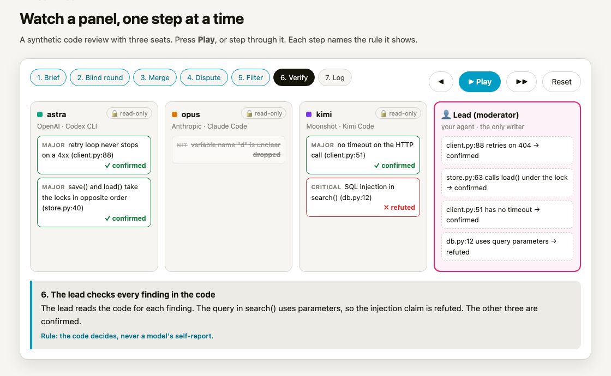
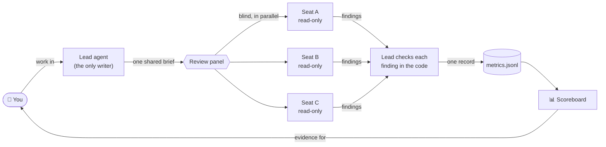
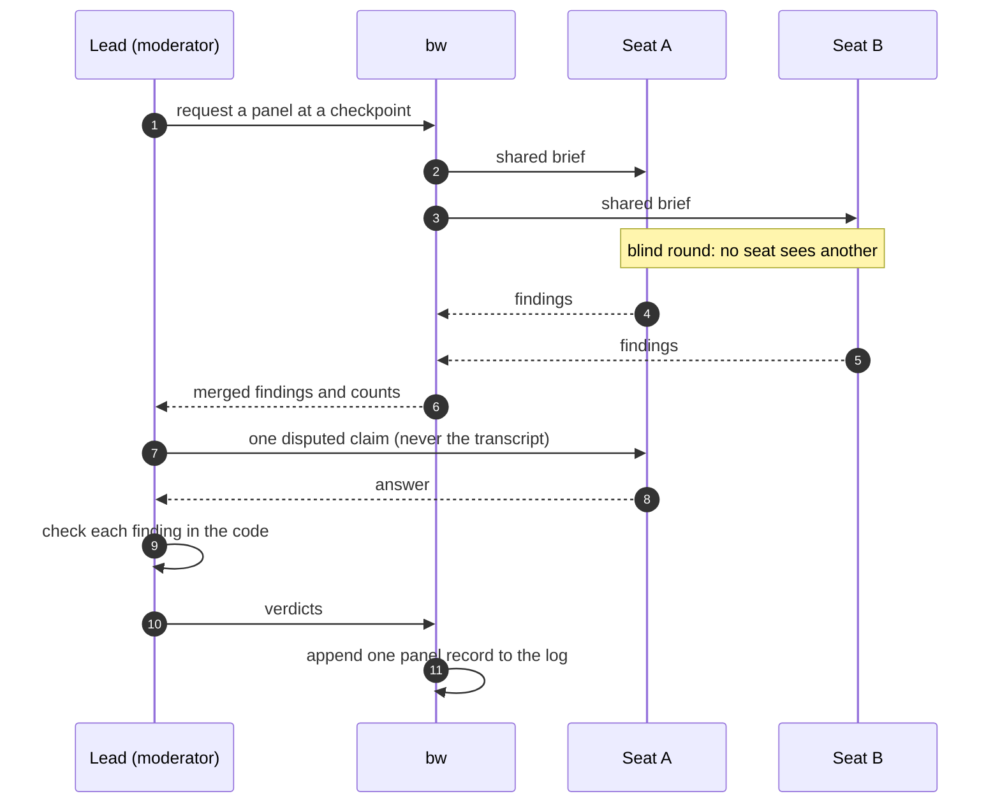
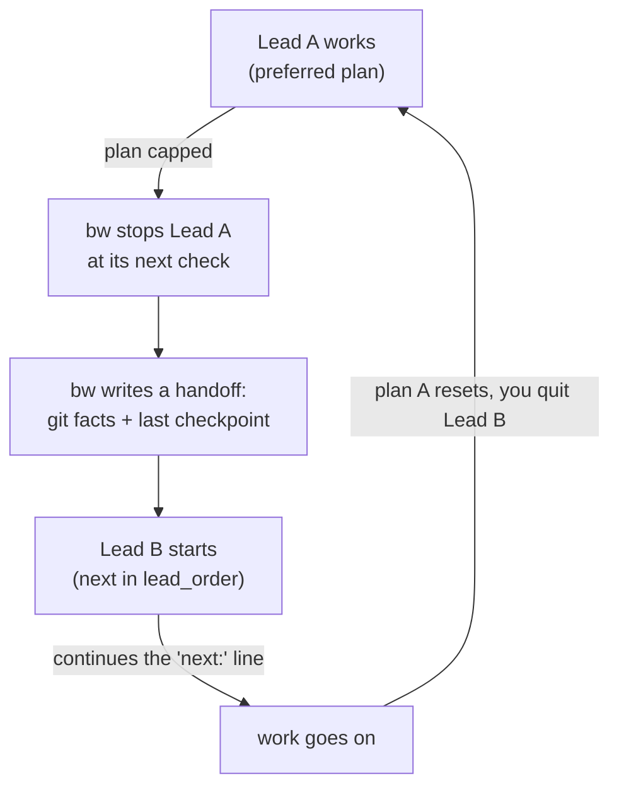
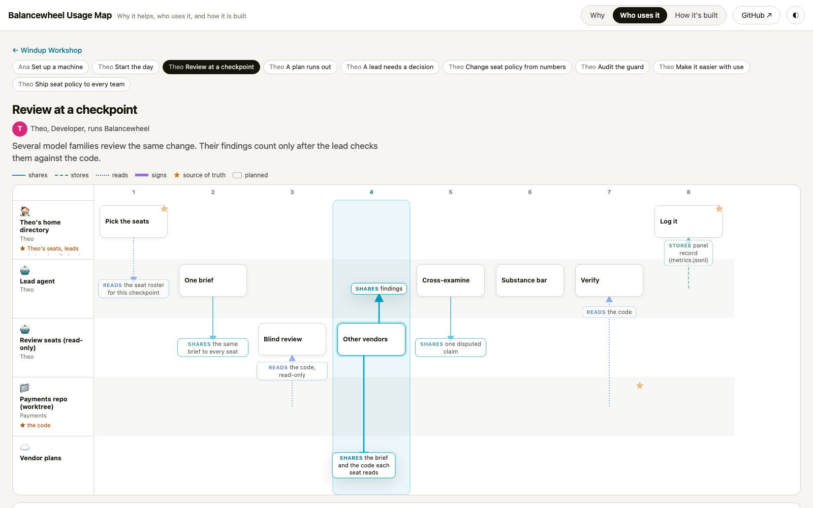
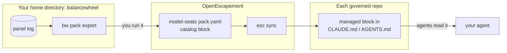

<p align="center"></p>

# Balancewheel

**Moderated multi-model agent collaboration, with the receipts to tune it.**

You work in one coding agent: the **lead**. Balancewheel lets that agent ask other vendors'
agents for a **read-only review**, check what they found against the code, and **log the
result**. The log becomes a scoreboard. You choose your reviewers from that scoreboard, not
from a feeling.

<p align="center">
  <a href="https://tensorgroup.github.io/balancewheel/start/"><b>▶ Interactive guide</b></a> ·
  <a href="https://tensorgroup.github.io/balancewheel/usage-map/"><b>Usage map</b></a> ·
  <a href="#quick-start">Quick start</a> ·
  <a href="docs/leads.md">bw reference</a> ·
  <a href="docs/architecture.md">Design</a>
</p>

[](https://tensorgroup.github.io/balancewheel/start/)

## The idea in one picture



- **The lead** is the agent you already use, for example Claude Code. It is the only agent
  that changes your code.
- **Seats** are other vendors' command-line agents, for example Codex CLI or pi. They can
  read the repo. They cannot write to it. An attack test proves this for each seat.
- **A panel** is one review. The seats review without seeing each other. Only disputed
  claims are cross-examined. The lead checks every finding against the code.
- **The log** keeps every panel. The scoreboard shows which seat finds real problems.

Sibling project: [OpenEscapement](https://github.com/tensorgroup/openescapement) (`esc`).
Balancewheel *finds and justifies* a seat policy. esc *ships* that policy into repos as a
signed rule pack. See [Working with OpenEscapement](#working-with-openescapement).

## What a panel looks like

You normally never start a panel by hand. The lead convenes one at a checkpoint (a design,
a plan, a code review, a stuck bug), and you see three lines:

```text
Review panel (astra, opus; kimi absent: usage cap): 7 findings, 5 confirmed, 2 refuted, 0 dropped.
Most important: the retry loop never stops on a 4xx.
One dispute (astra against opus on the lock order). The code agreed with astra.
```

Line 1 comes from `bw`. Lines 2 and 3 come from the lead.



## Quick start

About 15 minutes, on macOS. You need Python 3.9 or newer, git, and at least one vendor CLI
that you are logged in to (for example Claude Code, Codex CLI, or pi). Nothing installs
system-wide. Everything is under your home directory. Other systems need their own sandbox
setup, and every seat must still pass `bw seat verify`.

**1. Get `bw`.** Clone it to a place that no lead edits, and link the command.

```sh
mkdir -p ~/.local/bin
git clone https://github.com/tensorgroup/balancewheel ~/.local/share/balancewheel
ln -sf ~/.local/share/balancewheel/bin/bw ~/.local/bin/bw
ln -sf ~/.local/share/balancewheel/bin/bw-statusline ~/.local/bin/bw-statusline
```

If your shell does not find `bw`, add the folder to your `PATH` (and to your shell profile,
so that new terminals get it too). The second command lists the commands:

```sh
export PATH="$HOME/.local/bin:$PATH"
bw --help
```

> Why a separate clone? A lead can edit its own worktree. If `bw` ran from that worktree,
> the lead could change the guard of its next session.

**2. Make a config and check it.**

```sh
mkdir -p ~/.config/balancewheel
cp ~/.local/share/balancewheel/balancewheel.example.json ~/.config/balancewheel/config.json
python3 ~/.local/share/balancewheel/metrics/log.py config
```

You see the whole config, checked, as JSON, and exit status 0:

```text
{
  "schema_version": 3,
  "canvas": "terminal",
  "plans": {
    "claude-plan": {
      "vendor": "anthropic",
  …
```

A mistake gives one line and exit status 2. Fix the key it names and run the check again:

```text
config error: seatz: unknown key
```

Step 3 shows what the example looks like. Before step 4, edit the config for the tools and
accounts you have: `tools`, `plans` (your subscriptions and API keys), `leads`, `seats`, and
`profiles` (the lead order and the panel rules for each project). Remove what you do not use,
and remove the references to it. Then run the check again. Otherwise step 4 spends quota on
seats you do not use, and step 5 updates tools you did not install.

**3. Look at the state.**

```sh
bw status
```

```text
plans:
  chatgpt-plan (plan): quota unknown — quota: none
  claude-plan (plan): quota unknown — statusline: no reading
    no quota reading yet; rotation is using observed caps only
  …
leads:
  astra: codex gpt-6-astra on chatgpt-plan · contained by self
  claude: claude-code opus on claude-plan · contained by self
inbox: empty
guard:
  no judge: gray calls are recorded as asks, nothing is stopped; the guard stays shadow (set guard.model to let it act)
```

- `contained by self` means the tool runs in its own sandbox.
- The `guard` checks a lead's tool calls. In `shadow` mode it only logs, and blocks nothing.
- "quota unknown" is normal on a new machine. To let Claude Code report its quota, set
  `bw-statusline <plan>` as its `statusLine` in `~/.claude/settings.json` (see
  [first run](docs/leads.md#start-leading-first-run)). For other leads, run `bw cap <plan>`
  when a plan runs out.

**4. Prove that each seat is read-only.**

```sh
bw seat list
```

```text
astra  codex  gpt-6.2-astra  plan=chatgpt-plan  fallback=gem  tier=default  verified=no (never verified)  capped=no
opus  claude-code  claude-opus-5-5  plan=claude-plan  fallback=-  tier=default  verified=no (never verified)  capped=no
…
```

A seat with `verified=no` never runs in a panel. Log each seat in first. Two seats need more
than the CLI's own login:

- A Claude seat: run `claude setup-token`, and export the token as `CLAUDE_CODE_OAUTH_TOKEN`.
- A pi seat: export `OPENROUTER_API_KEY`.

Put these in your shell profile, not only in this terminal: the lead that `bw start` opens
runs in a new terminal. Details: [seat logins](docs/leads.md#start-leading-first-run). Then
attack-test every seat:

```sh
bw seat verify
```

Each seat is asked to write a file, on a new session and on a resumed one. The write must
fail. A pass ends with one line per seat, and `bw seat list` then shows `verified=yes`:

```text
bw: recorded a seat pass for codex on …
```

The test spends a little model quota. A seat that is capped or not logged in shows
`seat <id>: pending — <reason>` and does not fail the run.

**5. Open a project with a lead.** Use the path of one of your git repositories in place of
`~/code/my-project`. Try a dry run first. It changes nothing:

```sh
bw start --dry-run ~/code/my-project
```

An excerpt (your output has one line per tool and per plan). Read every `would update` line
before you continue:

```text
bw start: dry run for ~/code/my-project (profile product); nothing is run or written
bw start: would update claude: claude update · lock runtime-claude-code · installer claude
bw start: would read quota for plan claude-plan
bw start: would check seats in the background
bw start: lead: claude (order)
bw start: would run: open -a Terminal ~/.local/state/balancewheel/start/98bf2f5e3750.command
```

Then run it for real. `bw start` updates your tools, re-checks containment, reads quota, and
opens the lead in a new macOS Terminal tab. On Linux, run `bw` inside the repository instead.

```sh
bw start ~/code/my-project
```

Inside a project, plain `bw` starts the lead in the terminal you are in. It does not update
tools or run checks.

**6. Work as usual.** The lead keeps a checkpoint and convenes panels. When its plan is
capped (the status line reports it for Claude Code; `bw cap <plan>` records it for other
leads), `bw` stops the lead, writes a handoff, and starts the next lead in your profile's order.

Try a first review. With some uncommitted changes in the repository, tell the lead: "Review
my uncommitted changes with a review panel, and check each finding against the code." Look for
a summary like the one in [What a panel looks like](#what-a-panel-looks-like).

**7. Answer what only you can answer.**

```sh
bw inbox
```

```text
bw: inbox empty
```

When a lead has a question for you, it shows here. Answer with `bw answer <id> "<text>"`,
then tell the lead to read its inbox.

**8. Read the scoreboard.**

```sh
python3 ~/.local/share/balancewheel/metrics/dashboard.py
bw improve
```

The first command writes `dashboard.html` in the state directory and prints its path. Open
it in a browser. The second suggests changes from how you work. On a new machine it says:

```text
bw: nothing to change yet; the evidence builds as you work
```

**Stuck?** Each step has a full reference in [docs/leads.md](docs/leads.md). For a guided
setup by your own agent, use the paste-in prompts in [Getting started](#getting-started).

## Everyday commands

| I want to… | Run | You see |
|---|---|---|
| Work on a project | `bw` (inside the project) | the lead starts in this terminal (no updates, no checks) |
| Open a project in a new tab | `bw start [path]` | one line per tool, quota, then `opened a Terminal tab for …` |
| See plans, leads, and asks | `bw status` | plans, worktrees, leads, inbox, guard |
| Answer a lead's question | `bw inbox`, then `bw answer <id> "<text>"` | the open asks; then `… tell it to look`: tell the lead to read its inbox |
| Use a different lead here | `bw lead --use <lead>` (undo: `bw lead --auto`) | that lead starts here; a change from the profile order is logged |
| Record that a plan ran out | `bw cap <plan>` | `bw: <plan> capped until …`; the running lead switches at the next check |
| Check the seats | `bw seat list` | one line per seat: `verified=`, `capped=` |
| Re-test a seat after an upgrade | `bw seat verify <id>` | `bw: recorded a seat pass for …` |
| See the scoreboard | `python3 ~/.local/share/balancewheel/metrics/dashboard.py` | the path of `dashboard.html` |
| See everything live | `bw cockpit` | a local, read-only page in your browser |
| Get suggestions | `bw improve` | changes worth making, with evidence |
| Ship seat policy to esc | `bw pack export --to <dir> --dry-run` | what the export would change, with nothing written |

All commands: `bw --help`, or [docs/leads.md](docs/leads.md).

## How a lead hands over when a plan runs out



`bw` switches a running lead only when its plan is capped, never when the plan is only low.
After the preferred plan resets, Lead B keeps running. When you quit it, `bw` says that Lead A
is available again, and your next `bw` starts Lead A.

## The core ideas (one screen)

1. **Peer CLI seats, not API calls.** Each non-primary model runs as its vendor's own
   repo-aware CLI agent (headless, read-only, own session store). No prompt
   translation layers, no provider mixing hacks — the orchestrator shells out and the
   seat explores the repo itself.
2. **Independence before debate.** Seats review in parallel without seeing each
   other's output; only *disputed, substantive* claims get cross-examined, with the
   specific claim relayed — never the whole transcript.
3. **A moderator with a substance bar.** Challenges must state what breaks and where.
   Style and wording objections are dismissed without relay — but still logged and
   scored against the challenger.
4. **Verification is the only gate.** The moderator verifies every surviving finding
   against the actual code before anything is acted on. Seats advise; evidence decides.
5. **The scoreboard closes the loop.** Every seat invocation and every dispute
   (challenger, both proposals, winner, why) is appended to a log; a dashboard renders
   win shares and confirmed-finding rates; seat policy changes cite the numbers and
   carry re-promotion criteria.
6. **Knowledge stays markdown; indexes are derived.** All shared knowledge is
   markdown in git. Search layers (FTS, embeddings) are disposable local caches.

## It gets better with use

`bw improve` reads the last 30 days of your log. It looks for patterns: decisions you
reversed, questions you only agreed with, session ratings, cap switches, leads you forced by
hand, seats that keep missing panels, and the one-line `@improve` notes leads write when you
correct them. For each pattern it names one change, with the evidence.

- Every rule needs a minimum sample. On a thin log it says nothing.
- It never changes your config or your rules. You make each change.
- It never suggests weaker safety checks.
- `bw improve done <key>` hides a suggestion until new evidence appears.
- Before a lead starts, `bw` prints one line when there is something to look at.

## How it works, in more detail

<details>
<summary>The roles, the protocol, and the metrics loop</summary>

Three roles, one protocol, one log.

- **Moderator.** The coding agent you already use (the reference setup uses Claude
  Code). It frames the target, runs the seats, cross-examines disputes, verifies every
  surviving finding against the code, and writes the record. It is the only thing that
  ever changes your checkout.
- **Seats.** Other vendors' own CLI agents, run by `bw seat` behind one interface —
  `bw seat <id> [-b] [-r] [-d dir] "prompt"` — that makes each one repo-aware, resumable
  per directory, and **enforced read-only** (the OS sandbox plus the CLI's own read-only
  settings; verified by trying to make it write, not by reading vendor docs). Models are a
  one-line config detail, never part of an interface.
- **Drivers.** The same CLIs, run as the *working* agent in a throwaway git worktree when
  the moderator's budget is the constraint, when you want a second worker in parallel on
  another subscription, or for mechanical work. A driver is writable by design and
  contained by the worktree plus the OS sandbox; a driver's vendor never reviews its own
  output.
- **The protocol.** One shared brief → blind parallel round → cross-examination of
  disputed claims only, rounds capped, seats wall-clock capped → substance bar →
  moderator verification → one structured `panel` record appended to an append-only
  JSONL log.
- **The metrics loop.** `metrics/` reads that log: per-seat win share, confirmed-finding
  rate, usage, and roster watches that flag panel bloat, skimmed verification, and a
  seat that has stopped contributing. Seat policy changes must cite those numbers.

Details: [docs/architecture.md](docs/architecture.md) (design and rationale),
[docs/reference-implementation.md](docs/reference-implementation.md) (the rebuild guide:
tools, versions, models, the settings that took debugging, the traps, the checklist).

</details>

## See it as a map

[`docs/usage-map/`](docs/usage-map/) is one zoomable page that shows how Balancewheel is
used: who takes part, where each thing lives, and nine journeys you can step through, from
setting up a machine to shipping seat policy to OpenEscapement. Its `bw` commands, modules,
config keys, and roster are generated from this repository and `balancewheel.example.json`.

[](https://tensorgroup.github.io/balancewheel/usage-map/)

To use it without the web, open `docs/usage-map/index.html` in a browser; it needs no
server. After the code changes, regenerate its data and reopen it:

```sh
python3 docs/usage-map/generate.py --open
```

## Status

**Design repo, mid-extraction.** The reference implementation runs as the author's
private tooling and is dogfooded daily. What is here: the full design, the rebuild guide,
dated session handoffs, and the code (Python 3.9+, standard library only, tested). Every
directory in the planned shape is here now, under the roadmap amendments of 2026-10-24
and 2026-11-22:

- `metrics/` — the log, the watches, and the dashboard.
- `lead/` and `bin/bw` — leads, rotation, the guard, and the starter.
- `seats/` — the runner behind `bw seat`: headless argv per runtime, the brief,
  per-directory sessions, caps and stand-ins, the OS sandbox for every seat, usage
  records, and attack-based verification.
- `panel/` — the seat briefs (templates) plus the mechanics behind `bw panel`. The
  moderator stays whatever agent you already run.
- `packs/` — `bw pack export`, the export of one marked catalog block in esc's
  `model-seats` pack.

The first tagged release that calls the extraction complete still waits for the last
criterion in [docs/roadmap.md](docs/roadmap.md): one person other than the author has
built the setup from this README alone.

## What gets installed, and where

Nothing is installed system-wide and nothing runs as a service. A setup edits or creates
a handful of files under your home directory, and `setup/paths.txt` is the single list of
them — the backup and restore scripts read the same file. Credentials are on purpose not
on it: the setup reads them and never writes them, and a backup that copies tokens around
is a liability. In the reference setup the paths are:

<details>
<summary>Every path a setup touches, the dependencies, and backup and restore</summary>

| Path | What lives there | Setup does |
|---|---|---|
| `~/.config/balancewheel/config.json` | seats, state dir, watches | creates from `balancewheel.example.json` (a setup built before `metrics/` was extracted may still have these paths built into its own scripts instead) |
| `~/.claude/CLAUDE.md`, `~/.claude/settings.json` | moderator rules, permissions | appends / edits |
| `~/.claude/commands/`, `~/.claude/skills/` | the panel and seat slash commands | creates files |
| `~/.claude/scripts/` | seat wrappers, guards, driver launcher | creates files |
| `~/.claude/state/` | metrics JSONL, session tables, seat agent dirs, dashboard | creates; grows. The directory is not backed up wholesale — dashboards and indexes rebuild, and seat agent dirs hold credentials — but **the metrics log inside it is**, resolved from your config's `metrics_log`. It is the one thing here you cannot regenerate |
| `~/.codex/config.toml`, `~/.codex/review.config.toml` | default profile, read-only review profile | edits / creates |
| `~/.pi/agent/settings.json`, `~/.pi/agent/models.json` | pi defaults and model pins | edits — *only if pi runs from its default agent dir; the reference setup gives each pi seat its own agent dir under the state dir, so these stay untouched there* |
| `~/.config/git/ignore` | tool-litter patterns | appends |
| `~/.codex/hooks.json`, `~/.gemini/settings.json`, `~/.gemini/config/hooks.json`, `~/.kimi-code/config.toml`, `~/.pi/agent/extensions` | vendor hook config | *nothing* — listed because [Orca](docs/orca.md), an optional canvas, adds its status hooks here (and to the Claude Code settings and Codex config above, plus pi extensions) on first launch; back up before installing it |
| `~/.cc-switch/settings.json` | [cc-switch](docs/stack.md)'s settings (usage view; optional) | creates, only when absent, before its first launch (`bw setup cc-switch`); refuses to overwrite a file that differs |
| `~/.local/state/balancewheel/inbox.jsonl` | the asks leads put to you, bw's notices, and your answers (`bw inbox`, `bw answer`); the user's own record | nothing at setup; backed up. Its `inbox-view/` answers files are regenerated from it and stay out |
| `~/.codex/auth.json`, `~/.pi/agent/auth.json`, your secrets file | credentials | reads only; never written, never backed up |

Everything on that list is under your home directory. A repo's own instruction files
(`CLAUDE.md`, `AGENTS.md`, `.claude/skills/`) are not on it: the setup never writes them,
and that is the layer [OpenEscapement](#working-with-openescapement) governs.

**Dependencies** (install and log in yourself; the setup does not do it for you):

- A primary agent: the reference setup uses [Claude Code](https://code.claude.com) with the
  superpowers plugin.
- One or more seat harnesses: [Codex CLI](https://github.com/openai/codex) on a ChatGPT
  subscription, and/or [pi](https://www.npmjs.com/package/@earendil-works/pi-coding-agent)
  on Node 22.19 or newer — install it with a manager that pins the tool to its own Node
  (`volta install @earendil-works/pi-coding-agent`), because pi's Node floor moves between
  releases and a plain `npm install -g` binds the copy to whichever Node is active. pi can
  also use the ChatGPT subscription; a Claude subscription through pi bills per token — see
  the rebuild guide.
- An OpenRouter key if you want a cheap metered seat.
- Python 3.9+ (standard library only) for `metrics/` and the tests; git and `gh` for the
  branch-and-PR flow; `sandbox-exec` (ships with macOS) if pi is used as a driver;
  shellcheck optional, for the wrappers.

**Back up first, restore if you want out:**

```sh
setup/backup.sh              # copies every existing listed path to ~/.balancewheel/backups/<UTC stamp>/
setup/backup.sh --dry-run    # shows what would be copied
setup/restore.sh --list      # backups on disk and what each holds
setup/restore.sh             # puts the latest backup back (after backing up the current state first)
setup/restore.sh <stamp>     # a specific one; --dry-run shows the plan
```

The backup reports listed paths that do not exist as "absent"; that is normal and means
the setup either has not created them yet or, as above, keeps that state elsewhere.

**If your setup keeps anything outside that list — an older layout, state in an unusual
place — put it in `~/.config/balancewheel/paths.local.txt`, one path per line.** The backup
appends it to `setup/paths.txt`, so you never have to edit a tracked file to protect your
own machine, and the restore picks it up because each backup carries the list it used.
Check what you are actually covered for with `setup/backup.sh --dry-run` before trusting it.

A restore is reversible because it snapshots the current state before touching anything.
It only restores paths that existed when the backup was taken; a file the setup *created*
is reported and left for you to delete, so nothing disappears that the script did not
first copy. Set `BALANCEWHEEL_BACKUP_ROOT` to keep backups elsewhere.

</details>

## Getting started

The [Quick start](#quick-start) above is the manual path. This section is the other path:
your own agent does the assembly for you.

You need: a primary coding agent you already use, at least one other vendor's CLI agent
on a subscription or API key you are willing to spend, and a repo to review. Read
[docs/reference-implementation.md](docs/reference-implementation.md) once, then let your
primary agent do the assembly. Paste this into it, from the root of this repo:

<details>
<summary>Paste-in prompt: set up a balancewheel panel on this machine</summary>

```text
Set up a balancewheel review panel for me.

0. Run setup/backup.sh first and show me the backup directory it printed; it copies
   every file in setup/paths.txt that exists before you change anything, so
   setup/restore.sh can put my originals back.
1. A backup is not a merge. Before writing anything, read every file on
   setup/paths.txt that already exists (my user-level instruction file, settings, the
   Codex and pi configs, the git ignore) and give me a merge plan, section by section:
   keep as is, merge into the new rules, or drop, with a reason for each. Call out
   anything that contradicts the panel rules (a seat allowed to write, a review that
   skips verification, a model pinned by a preview id) and recommend against keeping
   it. Wait for my answer. Then add the balancewheel rules as one clearly delimited
   block appended to my instruction file, never by rewriting what was there, and apply
   only the merges I approved. Same for the Codex and pi configs: existing profiles
   stay, the read-only review profile is added beside them.
2. If my primary agent is Claude Code and the superpowers plugin is not installed,
   install it (`/plugin install superpowers@claude-plugins-official`) — the panel checkpoints attach to its
   brainstorming, writing-plans, requesting-code-review and systematic-debugging skills,
   and its worktree-plus-PR flow is what drivers assume.
3. Read README.md, docs/architecture.md, docs/reference-implementation.md and
   docs/roadmap.md in full. The two rules that are never relaxed: seats are enforced
   read-only and verified by attack; first rounds are blind and only disputed claims
   are relayed.
4. Ask me which vendor CLIs I have installed and logged in (for example Codex CLI, pi,
   Gemini CLI), which subscription or key each one uses, and which model each should run.
   Warn me if a route bills per token behind a subscription login — the rebuild guide's
   driver-mode section explains which ones do.
5. For each seat, write a wrapper that implements the interface in the guide's "Seat
   wrappers" section: new or resumed session, an optional pre-built seat brief on new
   sessions, per-directory session persistence,
   read-only enforcement in every layer the guide lists for that CLI, a private scratch
   TMPDIR, a wall-clock cap, and a `usage` record appended via metrics/log.py. Pin the
   model in exactly one config line per seat.
6. Copy balancewheel.example.json to my config location, fill in the seats, and run
   `python3 metrics/log.py config` to validate it.
7. Run the verification checklist in the guide against every seat, fresh and resumed,
   and show me the evidence (the refusal text and the unchanged directory), not the
   model's own description of what it did.
8. Write me a moderator instruction file for the panel protocol (shared brief, blind
   round, dispute relay, substance bar, verification, the logging step) and run one
   panel on a file with two planted bugs so I can see the whole loop, including the
   record it appends and `python3 metrics/dashboard.py` rendering it.
9. If a repo I work in has an `.escapement/` directory, it is governed by OpenEscapement:
   read the managed block in its instruction files and show me every subject where a
   pack rule overlaps a moderator rule you wrote (which model reviews, what a review must
   cover). `esc status` tells you the block is in sync, not what it says. The pack's
   rule wins in that repo; do not edit the managed block to make them agree.
10. Keep a list of everything these docs did not tell you. I will send it upstream.
```

</details>

Nothing in this repo assumes a particular vendor. The reference setup names its own
choices so you can see a working combination, and its history shows why the model
names live in config: the first seat model was retired by its provider within a week.

### Starting a new project

The setup above is once per machine. Each new repo then needs three things: its own
instruction files, its OpenEscapement governance, and a check that the seats work in
that directory. Paste this into your primary agent from the root of the new project
(an empty directory is fine; fill in the two paths on the first line):

<details>
<summary>Paste-in prompt: start a new project with balancewheel and OpenEscapement</summary>

```text
Set up this directory as a new project that uses balancewheel and OpenEscapement.
Balancewheel is checked out at <path>, OpenEscapement at <path>; my rule-pack repo is
<git url or "none yet">. The project: <what it is, the language and stack, how it
builds and tests, one paragraph>.

0. Confirm the machine setup exists before touching this directory: the balancewheel
   config validates (`python3 <balancewheel path>/metrics/log.py config`), the seat
   wrappers my user-level instruction file names are on disk, and `esc` is installed.
   If any is missing, stop and tell me; the once-per-machine setup comes first.
1. Initialize git if needed, with `main` as the default branch and one empty initial
   commit, and add a `.gitignore` for the stack above. Ask me whether to create the
   GitHub repo now (`gh repo create`, private by default); if not, step 7 ends at a
   local branch.
2. Write `AGENTS.md` (what the project is, how to build and test, branch and PR
   conventions, commit prefix) and a `CLAUDE.md` that imports it with `@AGENTS.md`,
   so every agent reads one source. Keep the panel and seat rules out of these files:
   they are user-level, already in place, and the same for every repo. If this
   directory already has instruction files, do not overwrite them: read them, give me
   a section-by-section merge plan (keep, merge, drop, with a reason each, and a
   recommendation against anything that contradicts the rules above), and wait for my
   answer before writing. esc handles the rest in step 3: everything outside its
   managed block is preserved and reported as a local amendment.
3. Run `esc init --yes`. It detects the two files from step 2 and pre-fills `targets`
   with exactly those, so edit `.escapement/config.yaml` to `targets: [agents, skills,
   mcp]`: one managed block, in the file the other imports, and the pack's skills and
   MCP servers still render. (The marker offer never appears here: the files are
   uncommitted and the run is non-interactive, so the block lands at the top at first
   sync, which is what we want.) Point the config at my pack repo, a git source with a
   `ref` and a trusted signer. If I have none yet, copy `examples/packs/acme-org` from
   the esc checkout into a pack repo of my own next to this one, and before the first
   sync strip it to my rules: its example rules, paved-path pointers, skill, and MCP
   server entry belong to a fictional org, and a sync would install them as policy.
   Point the config at it as a local path with `trust: unsigned` and no ref, as esc's
   `examples/governed-service` config does; it serves until it has a signed tag or an
   org pack exists. Then `esc sync` and `esc status --check`. Add the esc GitHub
   Action only once the pack is a git source: the Action installs esc and runs
   `esc status --check` in a bare checkout, where a local sibling path does not exist.
4. Compare the managed block with the moderator rules in my user-level instruction
   file and list every subject both speak to. The pack wins in this repo; if that is
   not what I want, the fix is a pack change, not an edit to the block.
5. Attack one seat in this directory with a prompt that asks it to create a file here,
   fresh (`seat.sh -d . "<prompt>"`) and then resumed (`seat.sh -r -d . "<prompt>"`).
   Show me the guard's refusal and the unchanged directory, not the model's own account
   of what it did. Sessions are per directory, so a new project is a new session for
   every seat.
6. Run one panel on the project brief above, at the design checkpoint, and show me the
   record it appended and `esc status` still clean.
7. Commit the scaffold on a branch and, if there is a remote, open the PR, the same as
   every later change.
8. Keep a list of everything these docs did not tell you. I will send it upstream.
```

</details>

Once this has been run a few times, the mechanical steps (1, 3, 5) are candidates for
a `setup/new-project.sh`; the judgment steps (2, 4, 6) stay with the agent.

## Using it

- **Work the way you already do, on branches, by pull request.** The reference setup runs
  the [superpowers](https://github.com/obra/superpowers) skill lifecycle in Claude Code:
  brainstorm → worktree → written plan → execute → verify → review → finish the branch. We
  recommend it; it already puts every change in its own worktree and lands it by PR, which
  is the shape the panel and the drivers assume.
- **Review** happens at checkpoints of that lifecycle, not at the end: when a design
  converges, when a plan is written, at code review, and in debugging when the first
  hypothesis fails. Convene the panel, verify what survives, log the record.
- **Drive** when the moderator's budget is the constraint, when a second worker on a
  different subscription can take an independent, well-specified task in parallel, or
  for mechanical work. Start in your primary agent; reach for a driver from there. Match
  driver strength to how well-specified the work is: a weaker model is fine behind a
  written plan, tests, and the panel, and wrong for anything ambiguous. A driver's branch
  finishes like any other: pushed, opened as a PR, reviewed by the panel with the driver's
  vendor excluded.
- **Lead** with `bw lead` in each project's worktree; let rotation move you off a capped
  plan instead of switching tools by hand (see [docs/leads.md](docs/leads.md)).
- **Read the scoreboard** before changing roles. A seat is dropped or demoted on logged
  outcomes over a window, never on one bad review, and every change states what would
  earn the role back.

## Leads and rotation

The full reference for `bw` is in **[docs/leads.md](docs/leads.md)**: switching, what
`bw` detects by itself, containment, autonomy and the guard, `bw start`, quota sources,
question triage, the inbox, the cockpit, and the first-run steps with each seat's login.

## Working with OpenEscapement

[OpenEscapement](https://github.com/tensorgroup/openescapement) (`esc`) and balancewheel
are two layers of the same idea: rules that agents read every session. They divide the
work by *where the rule lives*.

| | Balancewheel | OpenEscapement |
|---|---|---|
| **Governs** | how *your* agent collaborates: moderator rules, seats, drivers, the scoreboard | what an *organization* requires in a repo: policy, paved paths, skills, MCP servers |
| **Writes to** | your home directory: the configuration in `setup/paths.txt`, plus its state directory and backups; and, only when you run `bw pack export --to <dir>`, the marked catalog block and the `version:` line of esc's `model-seats` `pack.yaml` | the repo: a managed block in `CLAUDE.md` / `AGENTS.md` / `GEMINI.md`, `GOVERNANCE.md`, `.claude/skills/`, `.mcp.json`, and its own `.escapement/` |
| **Installed** | once per machine | once per repo (`esc init`, `esc sync`), from a signed pack the org maintains |
| **Changes by** | a moderator instruction edit that cites the scoreboard | a pack version bump, reviewed as a diff in a PR |

They write the same file in one place only: `bw pack export --to <dir>` rewrites the marked catalog block and the `version:` line of esc's `model-seats` `pack.yaml`, only when you run it. esc never writes your agent's configuration: nothing
under `~/.claude/`, no wrapper, no credential. What it does keep under your home
directory is its own: a pack cache in the OS cache directory and, if you run its portal,
that data under `~/.escapement/server`. Its one look at agent configuration is a read,
when `esc status` notices a pack-provided skill whose name also exists under
`~/.claude/skills` and reports it as an informational duplicate. Balancewheel's setup
never edits a repo's instruction files.



**One, the other, or both.** Each works alone; together they close a loop.

- *Balancewheel only.* You want a review panel and a scoreboard for your own agent, and
  there is no org policy to ship. Nothing here needs esc: the moderator rules live in
  your user-level instruction file and go with you to every repo.
- *OpenEscapement only.* An org wants its rules in every repo's instruction files,
  signed and drift-checked. Nothing in esc needs a panel; its model packs carry model
  guidance whoever wrote it, and a repo can be governed before anyone has a seat.
- *Both.* You run the panel, and the policy it justifies (which model holds which seat,
  on what evidence) has to reach more than your machine. The log is the evidence; the
  pack is the delivery. esc's `examples/packs/` already carries model packs for
  Anthropic, OpenAI, and Z.ai, the vendors behind the reference setup's seats, each
  status with its reason and, where it departs from the vendor's own default, the
  condition that would reverse it, and a `model-seats` pack that is this repo's seat
  policy in pack form: seats named by role, the models behind them a dated config
  detail. `bw pack export` regenerates its catalog block from the log; you add the
  markers once. After an export, do three steps in the esc repo. Paste the changelog bullet
  that bw wrote to `state_dir/packs/model-seats-<version>.md` into esc's `CHANGELOG.md`.
  Re-sign the pack with esc. Commit `pack.yaml` and `CHANGELOG.md` together.

**Install balancewheel first, then esc per repo.** That is the recommended order, not a
dependency: neither tool reads the other's state. Balancewheel is the working
environment; esc is what each repo asks of whoever works in it. Your agent reads both the user-level file and the repo's file, and
where a pack rule and a moderator rule disagree on the same subject (which model reviews,
what a review must cover), the pack's rule is the org's call for that repo. Reconcile by
comparing your rule with the managed block after `esc sync`, never by editing the block:
esc reports the edit as drift, `esc status --check` fails the build, and `esc sync`
declines to overwrite the edit until someone forces it. Adjust your own rule, or open a
PR against the pack.

**The hand-off.** Balancewheel's log is the evidence a seat policy stands on, and a rule
pack is the form that policy takes once it applies to more than one person. The
`packs/` directory exports seat policy in esc's rule-pack shape (roles per target kind,
the substance bar, the re-promotion criteria), with the dashboard numbers cited in the
pack's changelog and the version bump reviewed like any policy change. esc's `model-seats` example pack is that policy in pack form today, written by hand;
`bw pack export` now regenerates its catalog block from the log. Once a pack carries the panel protocol as a
skill, keep the pack's copy in each repo and drop your user-level one, so the version
agents run is the signed one.

## Maintaining it

- **Re-verify by attack after any harness upgrade.** Both directions for drivers (a write
  inside must land; a write to the checkout, including through a symlink, must be
  refused) and the read-only checklist for seats. An upgrade is the one thing that can
  silently loosen a guard.
- **Log every panel**, with the findings themselves, not just counts — the watches and
  the dashboard are only as honest as the records. Verdicts come from the moderator's
  code check, never model self-report.
- **Act on the watches.** They are printed after each panel: triage in-panel when
  findings bloat, re-verify a sample when nothing was refuted, consider dropping a seat
  that has stopped contributing. Roster changes are a human decision.
- **Keep temp files out of the checkout.** Wrappers reset `TMPDIR` to a private scratch
  directory; the guide's "Temp-dir hygiene" section says why and what to ignore.
- **Date the docs.** Each doc's preamble says when it was written and what changed
  since; session handoffs under `docs/handoffs/` are point-in-time and the owning doc
  wins when they disagree.
- **Run the tests** from the repo root: `python3 -m unittest discover -s tests -v`. They
  cover `metrics/` and exercise the backup and restore scripts against a temporary home.

## License

[Apache-2.0](LICENSE). Copyright 2026 Tensor Group, LLC and William Zajac; the `NOTICE` file carries the attribution that downstream copies must keep.
